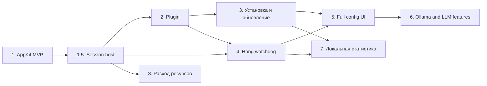

# План реализации Agent Watch

Здесь этапы развития, состояние каждого, критерии готовности и решения, которые ещё не приняты.
Чего здесь нет: что осталось до 1.0 и ближайший релиз — это [план до 1.0](release-plan.md);
как устроено то, что уже сделано, — остальные документы в `docs/`; что и когда сделано — история
git.

**Статус исходного плана наблюдения на 10.10.2026:** этап 1 — функциональная alpha и dogfooding; последний релиз — 0.5.0 (2026-11-22), с
changelog и окном обновления, где видно, что изменилось.
**Дата актуализации плана:** 2026-11-23

## Управляемая память

Согласовано направление: один сервер Agent Memory MCP на подключённую базу, общий для
Agent Watch и агентов. [План установки, управления и обновлений](proposals/managed-memory.md)
разделяет изменения между двумя репозиториями. Выполнена [изолированная проверка общего
подключения](research/managed-memory-connection.md) через Claude Code CLI и Codex app-server.
Она также выявила ошибку корректной остановки сервера с подключёнными клиентами. До завершения
первого этапа остаются её исправление, проверка настольных окон, Связки ключей, выбора базы
для проекта и установки службы. Реализация продукта ещё не начата.

## Вехи работы с проектами

[Предложение о развитии](proposals/project-workspace.md) объясняет выбор функций, цену и компромиссы.
Ниже — порядок выполнения. Первая поставка заканчивается вехой 2. Проверку Windows можно
начинать параллельно; её результат определяет объём отдельной поставки для этой системы.

| Веха | Когда она готова |
|---|---|
| 1. Посмотреть правило Git на Mac | В настройках человек выбирает рабочую папку, вводит `release` и видит причину и ожидаемое подтверждение. Если результат зависит от сервера, экран объясняет условие. |
| 2. Изменить и применить защиту Git | Видно общее правило и исключение проекта. После изменения правила оба агента запрашивают нужное подтверждение. Проверены чистая установка, переход с Mothership без двойного запроса, отмена, изменение ветки во время подтверждения и работа при закрытом приложении. |
| 3. Проверить Windows | В каждом настольном клиенте на тестовом репозитории проверены получение запроса, отмена и одобренное действие. По результату известны границы поддержки и цена переноса. |
| 4. Объединить проекты и сессии | Обе системы агентов узнают один репозиторий и его рабочие копии. «Недавние» ограничены по размеру, быстрые фильтры ведут к точному чату, проверен возврат после перезапуска. |
| 5. Разобрать рабочие копии и место на диске | Видны размер, владелец, причина запрета и доступное действие. Сначала проверить очистку сборки с сохранением исходников, затем отдельно — удаление завершённой копии. Использовать ту же проверку удаления, что и для агентов. |
| 6. Показать подписки и расход | Для двух профилей проверены принадлежность лимитов, срок обновления и расход по моделям. Досрочное восстановление добавляется после проверки профиля и объяснения последствий до подтверждения. |
| 7. Запустить доверенную программу с секретом | Проект подключён к системному хранилищу. На учебных данных проверены повторный запуск, отказ, изменение программы и отсутствие секрета в ответах и журналах. |

### Состояние рабочей версии на 20.11.2026

1. В настройках Mac можно посмотреть и изменить правило проекта. Обе команды используют ту же настройку Git, что и исполнитель. Снятие правила проекта требует подтверждения.
2. Agent Watch устанавливает обработчик Git отдельно в каждый профиль Claude и Codex. Исполнитель на Rust входит в приложение. Правила остаются в конфигурации репозитория. Переход существующих пользователей: сначала Agent Watch 0.5.0, затем Mothership без защиты Git. [Подключение и проверка обновления](git-protection.md).
   19 ноября 2026 года прошла сквозная проверка `push_once` через Mothership в обычном чате Codex на сборке Agent Watch `6ac27a52`. Пользователь подтвердил удаление в окне Agent Watch. `git ls-remote` подтвердил, что тестовой ветки в `origin` больше нет. [Сквозная проверка в Codex](git-protection.md#сквозная-проверка-в-codex).
   На macOS отдельно проверено обновление Agent Watch в обоих клиентах. Правила сохранились,
   а отправка блокировалась, пока комплект приложения был недоступен. Сквозные сценарии написаны
   на Rust (`native/git-protection-e2e`) и проходят в одноразовой виртуальной macOS. [Проверка обновления и закрытия чата](git-protection.md#проверка-обновления-и-закрытия-чата).
   Защита Git вышла в 0.5.0, опубликованная `v0.4.0` обновилась до неё в чистой macOS 26.6.2.
   Mothership больше не регистрирует свой обработчик Git и сервер `push_once`
   ([mothership#34](https://github.com/glockbender/mothership/pull/34)). Осталось проверить на
   живой установке после обновления обоих продуктов, что одно опасное действие вызывает ровно одно
   подтверждение Agent Watch.
3. Для Windows подготовлен автономный учебный репозиторий с локальным сервером и сверкой веток до и после отмены. Его подготовка проверена на Mac. Испытание в обоих настольных клиентах Windows остаётся открытым. Сначала проверить работу Git, затем оценить перенос окон.
4. Окно проектов объединяет наблюдаемые чаты Claude и Codex по репозиторию. Недавние ограничены двадцатью, есть поиск, фильтры и переход в чат. Сохранённая привязка проверена на учебных данных. Ещё предстоит проверить переход из окна в оба установленных настольных клиента.
5. Отчёт сравнивает полные размеры связанных рабочих копий и объясняет, почему можно убрать конкретную папку сборки или нужно её сохранить. Для явно помеченного, исключённого из Git кэша доступно перемещение в Корзину с подтверждением и повторной проверкой. На отдельном проекте Cargo проверены очистка с последующей сборкой, сохранность исходников и отказ для копий с локальными правками и блокировкой Git. Удаление завершённой рабочей копии целиком остаётся отдельной задачей. [Рабочие копии](worktree-disk.md).
6. В окне проектов видны последние известные лимиты по папкам агентов, время наблюдения и доступное число токенов одного чата Codex. Принадлежность подписки после смены пользователя, расход по моделям и досрочное восстановление лимита требуют отдельной проверки.
7. На учебной программе проверены повторный запуск разрешённой сборки, отказ после подмены файла и отсутствие её вывода в ответе. Следующий шаг — связать приложение с тестовой Связкой ключей на отдельной машине и проверить системные запросы при повторном запуске. [Проверка доверенной программы](trusted-program-launch.md).

Из Центра уведомлений macOS доступны проекты, ожидающие ответа чаты и настройки. К ожидающим чатам ведёт оранжевый маячок на полноэкранных рабочих столах или во всех режимах.

Режим у камеры и управление сном отложены до проверки основных сценариев.

## Исходная цель наблюдения

Создать лёгкое самодостаточное macOS-приложение, которое показывает состояния параллельных Claude
Code и Codex-сессий, а затем постепенно получает диагностику зависаний, удобную настройку и
локальные LLM-возможности.

План намеренно разбит на вертикальные стадии. Каждая должна дать проверяемый пользовательский
результат и новую обратную связь, а не только подготовить инфраструктуру для следующей.

## Зафиксированные решения

- Первый релиз — только Apple Silicon (ARM64), macOS 14+. Intel и universal-сборка не планируются.
- Runtime и единственный источник состояния находятся в `AgentWatch.app`.
- Отдельный daemon не создаётся.
- Приложение строится AppKit-first и продолжает работать после закрытия окна настроек.
- Claude и Codex передают события напрямую приложению через hooks.
- Общей упаковки на две экосистемы нет: у Claude Code это каталог-плагин, который приложение
  создаёт целиком, у Codex — слияние в его собственный файл хуков. Почему одного механизма не
  получилось — [agent-integration.md](agent-install.md#отклонено-плагин-с-хуками-у-codex).
- Установку, обновление и проверку интеграций выполняет само приложение; отдельного инструмента
  установки нет.
- Файлы состояния — внутренняя деталь приложения; внешние клиенты, когда появятся, пойдут через
  версионированный локальный API.
- Базовые состояния вычисляются детерминированно. LLM не участвует в определении фактов.
- Watchdog сообщает о потенциальном зависании и объясняет причины, но не выдаёт эвристику за
  доказанный факт.
- Данные и аналитика локальны по умолчанию.

## Последовательность и зависимости

Этапы 4 и 7 могут частично идти параллельно после стабилизации event model и локального API. Этап 6
начинается только после отдельного выбора LLM-сценариев.

### Состояние этапов

| Этап | Статус | Что осталось |
|---|---|---|
| 1. AppKit MVP | **active dogfooding** | замеры простоя и обратная связь для этапов 4 и 5 |
| 1.5. Session host | **сделан, с известными границами** | ничего; границы — в критериях этапа |
| 2. Встраивание в агентов | **сделан** | проверка в релизной матрице — [план до 1.0](release-plan.md#4-проверить-релизную-матрицу) |
| 3. Установка и обновление | **частично** | changelog и окно обновления — с 0.4.0, что осталось — [после 0.5.0](release-plan.md#после-050); подпись Developer ID, чистая установка, новый агент после первой настройки — [план до 1.0](release-plan.md#что-осталось-до-10) |
| 4. Hang watchdog | planned | всё |
| 5. Full config UI | **частично** | окно настроек есть ([ADR-0016](adr/0016-every-setting-lives-in-one-window.md)); запуск при входе и настройки будущих этапов |
| 6. Ollama и LLM | planned, product gate required | всё |
| 7. Локальная статистика | planned | всё |
| 8. Расход ресурсов | proposed | всё; сначала решения из [предложения](proposals/resource-usage.md#что-решить-до-начала) |

## Этап 1. AppKit MVP и dogfooding

**Цель:** получить полезный виджет с достоверными состояниями сессий без диагностики зависаний.

### Dogfooding

- использовать приложение самим в реальных параллельных задачах;
- вести короткий список неверных и непонятных состояний;
- записывать ситуации, когда всё равно пришлось вручную открывать сессию;
- затем дать debug-сборку нескольким коллегам;
- собирать только осознанно отправленный feedback, без фоновой отправки transcript или команд.

### Критерии готовности

- [x] одновременно отображаются Claude и Codex-сессии;
- [x] режим планирования визуально отличается от исполнения;
- [x] основной агент, ожидающий дочернюю работу, не выглядит как безымянное состояние «работает»;
- [x] строка показывает виды текущей работы счётчиками
  ([ADR-0011](adr/0011-the-row-is-a-template-with-one-gap.md));
- [x] клик по строке как минимум активирует правильное host application;
- [x] точный переход используется только тогда, когда окно и вкладку можно назвать достоверно;
- [x] карточка говорит, когда клик сделает не то, что обычно; неверная вкладка не выбирается
  эвристически;
- [x] переходы фаз и жизненный цикл параллельных активностей покрыты тестами;
- [x] закрытие окна не останавливает мониторинг;
- [x] отключённый Agent Watch не замедляет и не ломает агента;
- [x] перезапуск возвращает сессии, за которые ещё есть кому поручиться, и не возвращает остальные;
- [ ] idle CPU, память и wakeups измерены против бюджетов — бюджетов пока нет (открытые решения);
- [ ] feedback достаточен для уточнения этапов 4 и 5.

## Этап 1.5. Session host: закрытие терминала и фокус

**Цель:** связать сессию с фактическим процессом агента без launcher'а и использовать эту связь для
двух действий: достоверно показать завершение сессии и поднять окно host-приложения кликом по
строке.

### Критерии готовности

- [x] завершение процесса агента переводит сессию в `session closed` не позднее чем через 10 секунд;
- [x] клик по строке активирует корректное host application или карточка честно говорит, что
  поднимать нечего;
- [x] завершение процесса не интерпретируется как нормальный `Stop` turn;
- [x] нет launcher'а и PTY proxy; обход процессов идёт, только пока есть живые строки;
- [x] process mapping и exit transitions покрыты детерминированными тестами.

Границы, принятые сознательно:

- закрытая вкладка терминала JetBrains оставляет агента живым, и события у этого нет: строка
  получает фазу `terminal closed` на ближайшем обходе, пробуждении, открытии меню или клике, а не за
  10 секунд ([ADR-0013](adr/0013-a-click-ends-an-agent-its-closed-terminal-left-behind.md));
- у Codex Desktop нет наблюдения за процессом каждой сессии: его runtime общий для нескольких
  задач, поэтому закрывает все его сессии только выход самого приложения.

## Этап 2. Штатная установка хуков из приложения

**Цель:** заменить временную debug-конфигурацию hooks на штатную и обратимую установку. Как она
устроена у каждого агента — [agent-integration.md](agent-integration.md).

### Критерии готовности

- [x] установка не требует ручной правки settings-файлов;
- [x] тестовое событие появляется в Agent Watch;
- [x] выключенное приложение не влияет на работу агента;
- [x] обновление не создаёт дублирующиеся hooks;
- [x] удаление полностью прекращает доставку событий и не трогает чужие записи.

## Этап 3. Установка, обновление и первый запуск

**Цель:** довести путь от скачанного пакета до работающего мониторинга без ручной сборки
компонентов. Как устроены релиз и самообновление — [distribution.md](distribution.md).

### Критерии готовности

- [ ] новая машина проходит путь от скачанного пакета до работающего HUD без ручного редактирования
  settings-файлов и без `xattr`;
- [x] повторная установка интеграции идемпотентна (повторный запуск ничего не меняет);
- [ ] обновление сохраняет настройки и историю — проверить в релизной матрице;
- [x] отказ от обновления не мешает работе текущей версии;
- [ ] новый агентский инструмент, появившийся после первой установки, обнаруживается и предлагается
  к подключению;
- [ ] несовместимые версии диагностируются понятным сообщением;
- [ ] удаление не затрагивает пользовательские данные без отдельного выбора;
- [ ] когда запись в файл агента не удалась (нет прав, каталог только для чтения, шаг доверия у
  Codex), приложение показывает, что вставить руками, а не только «не получилось».

## Этап 4. Проверка потенциальных зависаний

**Цель:** отличать просто долгую работу от операций, которые с высокой вероятностью перестали
продвигаться.

### Сначала — проектирование на реальных данных

- собрать из dogfooding типовые длительные и реально зависшие операции;
- определить доступность PID/process-tree для Claude и Codex;
- проверить стоимость CPU, I/O и FSEvents sampling;
- определить объяснимые сигналы и мягкие пороги;
- разделить foreground tool calls и фоновые процессы;
- определить поведение после sleep/wake.

### Реализация

- возраст незакрытой shell-операции;
- адаптивный sampling только активных операций;
- process existence и CPU-time delta;
- файловая активность через FSEvents;
- несколько измерений перед предупреждением;
- объяснимый `stuck score`;
- действия `snooze` и «ожидаемо долгая команда»;
- локальные baseline по типам команд после накопления истории.

Не входят в первую версию: чтение всего stdout, универсальный PTY proxy, автоматическое завершение
процесса, точный контроль любого процесса, запущенного через `&`, LLM как единственный детектор.

### Критерии готовности

- предупреждение всегда содержит наблюдаемые причины;
- обычные долгие сборки не создают постоянный шум;
- ожидаемое предупреждение можно быстро подавить;
- sleep не увеличивает ошибочно длительность работы;
- overhead watchdog измерен отдельно от idle-режима;
- эвристики покрыты воспроизводимыми сценариями и тестами.

## Этап 5. Полноценный config и management UI

**Цель:** сделать настройку понятной без редактирования файлов и знания внутренней архитектуры.

Окно настроек уже есть: все настройки живут в одном окне
([ADR-0016](adr/0016-every-setting-lives-in-one-window.md)). Осталось:

- запуск при входе;
- настройки этапов, которых ещё нет: предупреждения и snooze watchdog, модели и лимит памяти,
  срок хранения статистики.

Принципы: ясность уровня Handy, а не его внешний вид; показывать состояние интеграции и следующее
действие; технические параметры — в стороне от основных; последствия удаления данных или модели
видны до подтверждения; работоспособные умолчания без обязательной настройки.

### Критерии готовности

- [x] базовая настройка выполняется полностью через UI;
- [x] состояние интеграции диагностируется без чтения логов;
- [ ] экран интеграций показывает доступный уровень навигации для Codex Desktop, а не только для IDE;
- [ ] HUD остаётся компактным;
- [ ] окно не держит локальную модель в памяти после закрытия.

## Этап 6. Ollama и согласованные LLM-функции

**Цель:** добавить локальную интеллектуальную обработку только для сценариев, доказавших полезность.

### Обязательный product gate

Перед реализацией отдельно выбрать функции из кандидатов:

- объяснение подозрительного зависания;
- summary сессии;
- автоматическое короткое имя сессии;
- классификация shell-команд;
- группировка повторяющихся проблем;
- приоритизация сессий, требующих внимания.

Для каждой функции нужны примеры входа, ожидаемый результат, latency budget и способ понять, что она
действительно помогает.

### Технический scope после согласования

- provider interface для local inference, Ollama как первый provider;
- каталог рекомендованных моделей и экраны Downloaded/Available в стиле Handy;
- профили «минимум ресурсов», «сбалансированный», «лучший анализ»;
- lazy loading и выгрузка после idle timeout;
- ограничение контекста и редактирование секретов;
- fallback на полностью детерминированное поведение.

### Критерии готовности

- приложение полезно и без модели;
- модель никогда не определяет фактическое lifecycle-состояние;
- idle-приложение не держит модель загруженной;
- до скачивания видны размер, потребление памяти и назначение;
- ошибка Ollama или inference не ломает мониторинг;
- функции проверены на заранее подготовленных примерах.

## Этап 7. Локальная статистика

**Цель:** дать локальную аналитику по накопленному журналу сессий. Журнала пока нет: приложение
помнит сессии только для восстановления после перезапуска.

### Работы

- журнал сессий и версионированный read API приложения;
- агрегация по источнику, проекту и периоду;
- отдельно считать `attention wait` (агент явно ждёт разрешения или ввода) и `review delay` (ход
  закончен, а человек к результату ещё не вернулся);
- показывать ошибки и suspected-stuck incidents;
- определить retention и экспорт.

### Критерии готовности

- метрики имеют однозначные определения;
- агрегаты можно проверить на небольшом журнале вручную;
- внешние читатели идут через версионированный API, а не через файлы приложения;
- данные остаются локальными, пока обратное не выбрано отдельно.

## Этап 8. Расход ресурсов по сессиям

**Цель:** показать, сколько памяти и процессора берут каждая сессия, её части (агент, MCP-серверы,
команды) и машина целиком, и дать выключить это полностью. Что можно узнать, какие числа и где их
показывать — [предложение](proposals/resource-usage.md). Начинать после решений из его раздела
[«Что решить до начала»](proposals/resource-usage.md#что-решить-до-начала).

### Работы

Каждый шаг заканчивается тем, что можно увидеть или проверить.

1. **Сборщик и привязка, без интерфейса.**
   - `AgentWatchLookup`: `ProcessResourceSampler` — список процессов, родитель, время запуска и
     `proc_pid_rusage`. Окружение и рабочую папку читает один раз на новый процесс и сразу
     превращает маркер сессии в метку строки через `HookCaptureRedactor.label(forRawIdentifier:)`.
   - `AgentWatchCore`: `ResourceAttribution` — чистая функция. Вход: таблица процессов, корни
     сессий и прошлый снимок. Выход: части каждой сессии, прирост процессора, «не привязано» и итог
     машины.
   - `AgentWatchApp`: `ResourceMonitor` — таймер раз в 5 секунд, только при включённой функции и
     живых сессиях. Пока интерфейса нет, снимок пишется в журнал отладки.
2. **Настройки и меню.** Панель `Resources` с общим выключателем и переключателем для каждого
   места. Итог агентов справа от сводки меню. Итог машины, где Agent Watch стоит отдельной строкой.
   ADR о главном числе памяти.
3. **Виджет.** Надпись справа от кнопок `Projects` и `Settings`. Новая часть шаблона строки.
   Блок в карточке строки с тремя самыми тяжёлыми частями сессии.
4. **`Projects & Recent` и закрытые сессии.** Текущие числа у открытых сессий. Итог проекта вместе с
   MCP-серверами Codex, найденными в его папках. Пик памяти и процессорное время у закрытых.
5. **Остальные хосты.** Проверить терминальные `claude` и `codex`, сессию после `/bg`,
   `codex exec` и расширение Codex для VS Code. Выяснить, почему у сессии Claude.app время
   завершённых потомков почти равно собственному.

По ходу меняются документы, которые описывают поведение: [widget.md](widget.md) (часть строки и
карточка), [menu-bar.md](menu-bar.md) (сводка), [settings.md](settings.md) (панель и ключи
`settings.json`), [architecture.md](architecture.md) (новый таймер в «Энергоэффективности») и
[agent-processes.md](agent-processes.md) (маркеры в окружении).

### Критерии готовности

- **Шаг 1:** тесты в `AgentWatchCoreTests` держат каждое правило привязки: дерево останавливается на
  корне другой сессии; процесс принадлежит ближайшему корню над ним, даже если унаследовал маркер
  родительской сессии; сирота находится по маркеру; оболочка берёт маркер у потомка; прирост
  процессора не уходит в минус; команды Codex делятся по тредам, MCP-серверы — по папкам. Тесты
  сборщика в `AgentWatchLookupTests` держат его кэш: новый процесс под старым номером читается
  заново. Память трёх живых сессий совпадает с
  Activity Monitor. Шаг опроса в приложении занимает меньше 5 мс и в среднем меньше 0,1 % ядра.
- **Шаг 2:** при выключенной функции нет ни таймера, ни чисел, и это проверяет тест. `StatusMenuTests`
  держат новый вид меню.
- **Шаг 3:** строка и карточка проверены отрисовкой вне экрана; есть тест на починку шаблона строки
  с новой частью; картинки README перерисованы, если изменились.
- **Шаг 4:** итог проекта сходится с суммой его строк и папок; числа закрытой сессии переживают
  перезапуск приложения.
- **Шаг 5:** результаты записаны в [agent-processes.md](agent-processes.md) с версиями программ;
  открытые вопросы предложения закрыты или перенесены сюда.

## Сквозные требования

- **Производительность.** Budgets для idle CPU, resident memory без модели, wakeups, времени hook
  sender, задержки HUD и overhead watchdog получить замером на целевом Mac, а не угадать.
- **Приватность.** Не хранить prompts, ответы и stdout по умолчанию; редактировать чувствительные
  аргументы до записи; не добавлять централизованную телеметрию без отдельного решения.
- **Совместимость.** Версия события есть в каждом запросе; приложение принимает предыдущую
  совместимую версию отправителя; local API, когда появится, версионируется.
- **Качество.** State machine проверяется табличными unit-тестами, адаптеры — на обезличенных
  payload fixtures; каждая найденная ошибка перехода получает regression fixture.

## Десктопные клиенты — аудит 2026-10-07

Человек перешёл с терминалов на Claude.app и ChatGPT.app. Замеры —
[«Десктопные приложения»](agent-processes.md#десктопные-приложения) и
[«Десктопные клиенты»](session-focus.md#десктопные-клиенты).

1. **Сделано:** десктопная сессия Claude узнаётся по записи реестра —
   [«Claude.app»](agent-processes.md#claudeapp).
2. **Сделано:** клик ведёт к самой сессии ссылкой клиента —
   [«Десктопные клиенты»](session-focus.md#десктопные-клиенты).
3. **Сделано:** Codex не теряет начало первого хода —
   [«Приём сеансов Codex, и открытый вопрос про `/clear`»](agent-events.md#приём-сеансов-codex-и-открытый-вопрос-про-clear).
   Решено человеком 2026-10-08: запуски без окна — своя категория у обоих агентов
   ([«Запуски без окна»](agent-processes.md#запуски-без-окна)), по умолчанию скрыта, клик
   предлагает её завершить ([ADR-0021](adr/0021-a-headless-run-is-hidden-until-asked-for.md)).
   Открыто: как `codex exec` отвечает на `SIGTERM` и `SIGINT` — на этой машине его запрос
   отклоняет один из хуков `UserPromptSubmit` (замер: Codex 0.153.4).
4. **Решено человеком 2026-10-07: оставить как есть.** Строка сессии, процесс которой Claude.app
   остановил за бездействием, закрывается, хотя сессия видна в приложении и продолжится по первому
   сообщению. Сама остановка на этой машине ни разу не наблюдалась.
5. **Статус-строки у десктопной сессии нет** — подтвердил человек. Процента контекста у неё не будет.
6. **Сделано:** значок вопроса MCP-сервера, проверен с человеком на настоящей установке
   2026-10-07 — [«Вопрос MCP-сервера: `Elicitation`»](agent-events.md#вопрос-mcp-сервера-elicitation).
   Каталог событий Claude закреплён тестом — [«Какие события мы просим»](agent-events.md#какие-события-мы-просим).
   Открыто: у `Notification` есть виды `agent_needs_input` и `worker_permission_prompt` (замер:
   Claude Code 2.1.293), а когда они приходят, не замерено. Если это ожидание человека, о котором
   другие хуки молчат, событие стоит просить.
7. **Сделано:** сессия, открытая в Claude.app без работающего приложения, находится по процессу с
   именем и кликом в саму сессию — [«Агент работает, а приложение о нём не
   слышало»](session-recovery.md#агент-работает-а-приложение-о-нём-не-слышало).

## Технический долг

**Правила агента по слоям.** Принцип — тип правил на агента в каждом слое
([agent-integration.md](agent-integration.md#где-это-живёт-в-коде)). Переведён слой
`AgentWatchLookup`. Остальные переводятся, когда их трогают:

- чтение транскрипта и имени сессии — `TranscriptLocator`, `TranscriptReader`,
  `SessionDescriptionResolver` и его ветка Codex в отправителе;
- запись реестра Claude: ядро состояний принимает `ClaudeSessionStatus` и проверяет
  `source == .claude` (`SessionStateEngine.apply`), а должно принимать общий факт «на диалог
  ответили»;
- установка хуков и значок.

## Сбои, которые не повторились

Оба — на одной демо-копии в виртуальной машине, в первую минуту после её запуска, 2026-10-09.
Причина не найдена; что её покажет — в конце каждого пункта.

- **Клик по строке виджета пропал.** Нажатие и отпускание пришли на строку ждущей сессии, а
  вкладка не открылась, и обращения к Ghostty в системном журнале нет (замер: macOS 15.7.7). Не
  повторилось ни в 36 кликах по строкам на работающей копии, ни в повторе дубля. Покажет строка в
  `event-debug.log` на нажатие и отпускание в строке.
- **Карточка строки при спрятанном виджете.** После выбора сессии в меню над терминалом появилась
  карточка строки (`SessionHoverCard`) другой сессии, хотя виджет был спрятан, а показывает её
  только `HUDPanelController` (замер: macOS 15.7.7). При повторе дубля не появилась. Покажет строка
  в том же журнале на показ и скрытие карточки, с сессией.

## Открытые решения

Каждое — с тем, что его решит.

- **Окончательный bundle identifier** (сейчас `com.glockbender.agentwatch` и у приложения, и у
  плагина). Блокирует первую загрузку плагина: после публикации идентификатор плагина не меняется
  ([план до 1.0](release-plan.md#1-отправить-текущий-плагин-на-первое-ревью-marketplace)).
- **Численные performance budgets.** Решит замер на целевом Mac.
- **Пороги и профили команд watchdog.** Решат данные dogfooding (этап 4).
- **Набор LLM-функций.** Решит product gate этапа 6.
- **Нужен ли централизованный сбор агрегированной статистики.** Решит отдельное продуктовое решение;
  по умолчанию — нет.
- **Статус-строка в других папках Claude.** Сейчас она подключается только в
  `~/.claude/settings.json`, и у сессии из другой папки нет процента контекста
  ([ADR-0022](adr/0022-a-person-names-the-agents-other-folders.md)). Решит просьба человека, которому
  этого не хватает.
- **Подтверждение хуков другой папки в самом Codex.** Что Codex читает только `$CODEX_HOME/hooks.json`,
  пропускает неподтверждённые хуки и запускает хуки, которым проверка не мешает, замерено; что
  подтверждение через его запрос сохраняется для этой папки и работает, — нет
  ([«Другие папки агента»](agent-install.md#другие-папки-агента)). Решит один интерактивный запуск
  Codex с другой папкой, в котором человек подтвердит хуки.
